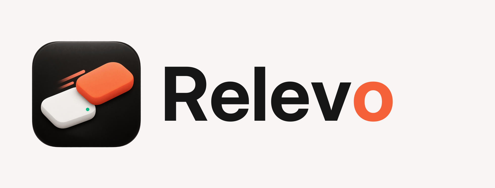
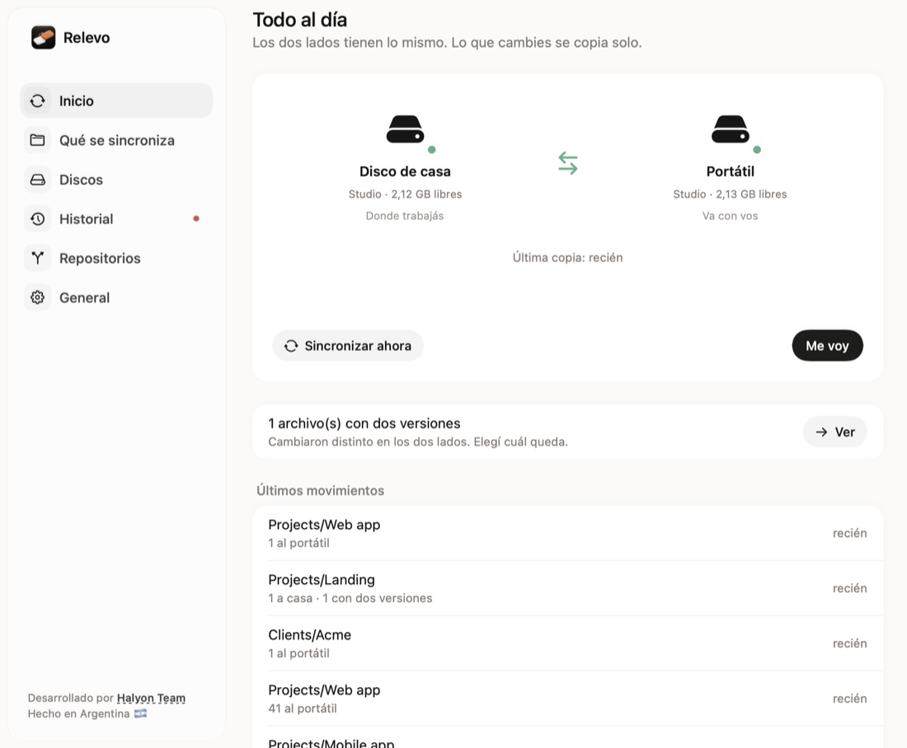
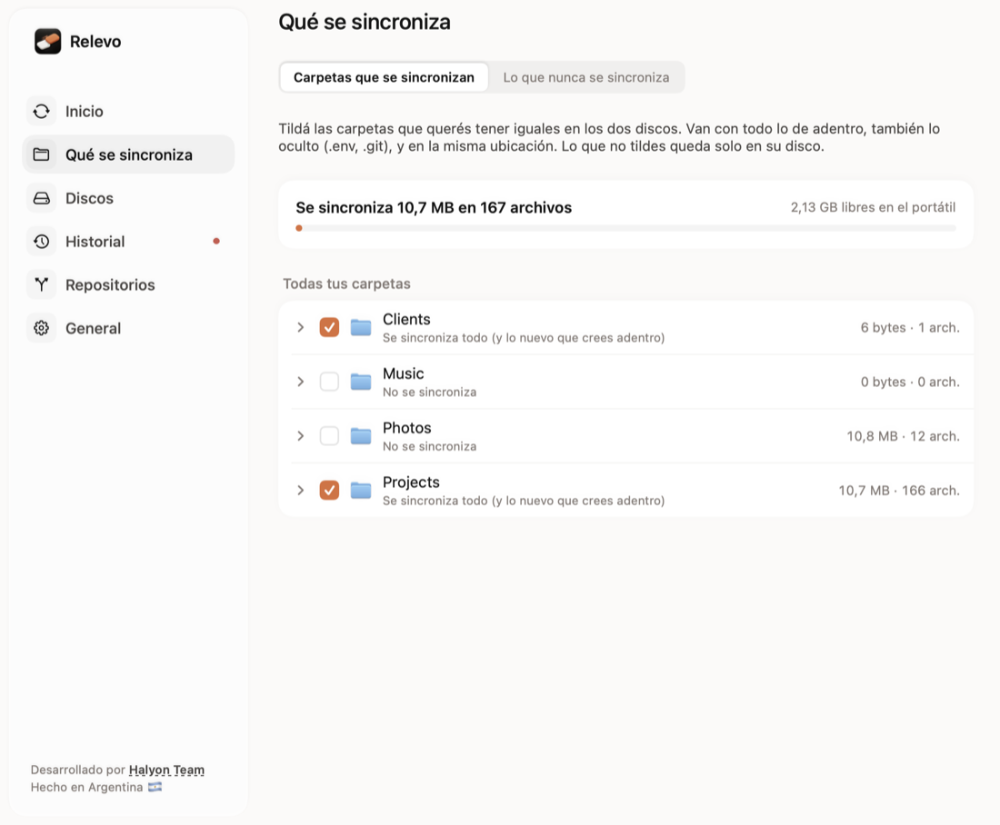
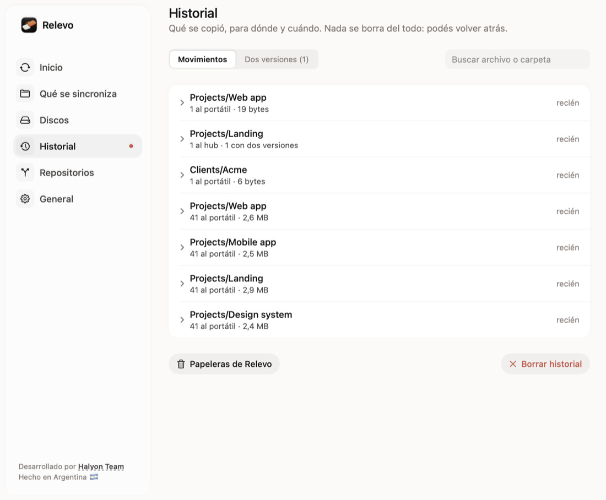

<p align="center"></p>

<p align="center"><b>Tu disco de trabajo, en casa y afuera, siempre igual.</b><br>
Una app chiquita de la barra de menú de macOS que mantiene idénticos, en los dos sentidos, un <i>hub</i> (el disco o la carpeta donde trabajás en casa) y un <i>disco portátil</i>.</p>

<p align="center"><a href="https://relevo.halyon.app">Sitio</a> · <a href="docs/MANUAL.md">Manual</a> · <a href="README.md">Read in English</a></p>

---

## Qué hace

- **Sincroniza en vivo y en los dos sentidos.** Con los dos discos enchufados, cada cambio se copia en segundos. Trabajás en el portátil en otro lado; al volver lo enchufás y Relevo trae esos cambios.
- **Revisa solo lo que cambió.** macOS lleva la cuenta de qué carpetas cambiaron en cada disco (aunque Relevo esté cerrado o el portátil se haya usado afuera): al enchufar, al abrir Relevo o con “Sincronizar ahora”, Relevo revisa solo esos proyectos y, adentro de cada uno, solo las carpetas que cambiaron (una carpeta nueva o movida se mira entera). Así, con uno o dos archivos pendientes, sincronizar es instantáneo aunque el proyecto tenga cientos de miles de archivos. Si no se puede saber con certeza (la primera vez, después de un corte de luz o de sacar un disco sin expulsarlo), revisa todo. Una vez por día, de madrugada, revisa todo por las dudas; si te vas mientras corre, se frena sola.
- **Expulsás y te vas.** Con los dos conectados todo se copia al toque, así que alcanza con expulsar el portátil (desde Relevo o el Finder). “Me voy” además copia lo último (solo lo pendiente: segundos) antes de expulsar. Si algo usa el disco, lo que corre de fondo se cierra solo y las apps con ventana te las muestra para cerrarlas con un clic.
- **“Esperá” al volver.** Cuando enchufás el portátil en casa (o prendés la Mac con los dos discos), Relevo les acomoda el nombre y trae lo que hiciste afuera. Si tarda más de unos segundos, un aviso te pide que esperes antes de abrir tus apps y otro te dice cuándo terminó y qué trajo. Si una app (por ejemplo Claude) ya se abrió en el portátil, te dice cuál cerrar y te avisa cuándo volver a abrirla, así nunca queda trabajando en el disco equivocado.
- **Las mismas rutas en todos lados.** Afuera, el portátil lleva el nombre del hub: tus proyectos quedan en la misma ubicación y tu editor, la terminal y tus herramientas encuentran todo. En casa se llama “<nombre> (portátil)”, así nunca hay dos discos con el mismo nombre y da igual cuál monte primero la Mac al prender. Relevo cambia el nombre solo, sin desmontar nada, y en casa puede ocultar el portátil del Finder.
- **Pensada para gente que programa y crea.** Las dependencias (`node_modules`, `.venv`, `Pods`) viajan por defecto, así afuera tus proyectos funcionan sin volver a bajarlas (se puede apagar). Lo que se compila de nuevo (`.next`, `.build`, `DerivedData`…) no se copia nunca. Los archivos ocultos (`.env`, `.git`) sí. Las bases de datos, los emuladores y las máquinas virtuales (`.avd`, `.utm`, `.vmwarevm`, `.pvm`) no se tocan mientras están prendidos y viajan una vez al cerrarlos, así nunca llega al otro disco una copia a medio escribir.
- **Nada se borra del todo.** Lo borrado o reemplazado va a la Papelera de Relevo de cada disco (3, 7, 30 o 90 días; de los archivos de 256 MB o más guarda solo la última versión). Desde el historial lo recuperás o volvés a la versión anterior, y desde General la vaciás cuando quieras. Si borrás un proyecto entero, Relevo te pide el OK antes de borrarlo del otro disco; si no respondés, se aplica solo a los 3 días.
- **Conflictos resueltos.** Si el mismo archivo cambió distinto en los dos lados, se guardan las dos versiones y elegís cuál queda. Si un proyecto tiene commits distintos en los dos discos, su carpeta `.git` no se toca (para no mezclar las historias) y te avisa para que los unas con git.
- **Segura aunque saques el disco en el medio.** Cada archivo se escribe con un nombre temporal y se renombra al final; un diario recuerda lo recién escrito, así un disco desenchufado de golpe se repara en vez de tomarse como un borrado tuyo.
- **Repositorios.** Clonás con un link o desde tu lista de GitHub al hub o directo al portátil, ves cuáles tienen cambios, commits sin subir o están atrasados, y los actualizás, hacés commit o unís ramas. Los que no te interesan se ocultan.
- **Y además:** varios vínculos (por ejemplo, proyectos a un disco y fotos a otro), árbol de carpetas con tamaños, revisión a fondo una vez por mes (comparación byte a byte), expulsar todos los discos de una, copia antes de dormir, pausa por una hora o hasta mañana, cifrado opcional del disco con la clave guardada en el llavero, atajos de teclado y enlaces `relevo://` para Atajos, Raycast o Alfred, español e inglés.

Memoria: ~30 MB en reposo, sin fugas. Una copia chica (lo de todos los días) usa unos pocos MB más, aunque el proyecto sea enorme: en uno de 500.000 archivos, sincronizar un archivo cambiado tarda 0,3 s y ~10 MB. Solo la revisión completa (la diaria, o tras un corte) mira todo: ~650 bytes por archivo, que devuelve al terminar.

## Capturas

| Inicio | Qué se sincroniza | Historial |
|---|---|---|
|  |  |  |

## Requisitos

- macOS 14 o más nuevo, Mac con Apple Silicon.
- Para compilar: Swift 6 (Xcode o solo las herramientas de línea de comandos: `xcode-select --install`).
- El portátil tiene que estar en formato **APFS** (Utilidad de Discos). Los discos exFAT/FAT no guardan permisos ni enlaces y se pueden dañar si se sacan de golpe.

## Compilar e instalar

Todavía no hay descargas listas: la compilás vos, tarda un minuto.

```bash
git clone https://github.com/Halyon85/relevo.git && cd relevo
./compilar.sh            # arma build/Relevo.app
./compilar.sh instalar   # además la copia a /Applications y la abre
```

No hace falta una cuenta de desarrollador de Apple. `compilar.sh` la firma con tu certificado "Apple Development" si tenés uno; si no, con una firma local (macOS puede volver a pedir permisos después de cada compilación). La primera vez, macOS pide permiso para mandar avisos y para acceder a discos externos.

Para actualizar, bajá el código nuevo y compilá otra vez: `git pull && ./compilar.sh instalar`. Las versiones que publique Halyon Team (cuando las haya) se actualizan solas con [Sparkle](https://sparkle-project.org): mirá [docs/PUBLICAR.md](docs/PUBLICAR.md).

El manual completo, pantalla por pantalla, está en [docs/MANUAL.md](docs/MANUAL.md).

## Pruebas

Todo se prueba con **imágenes de disco**, nunca con discos reales:

```bash
swift run RelevoPruebas                 # todos los escenarios del motor, dos veces: revisión entera y por zonas
herramientas/prueba-desenchufar.sh 12   # desenchufes forzados a mitad de copia, de los dos lados
herramientas/prueba-app.sh              # la app entera de punta a punta, memoria y fugas
herramientas/prueba-cifrado.sh          # cifrado sobre un disco de ensayo
herramientas/prueba-inteligente.sh      # revisar solo lo que cambió (Relevo cerrado, afuera, sin registro, corte de luz) y frenar la revisión diaria al irte
herramientas/prueba-discos.sh           # nombres de los discos (al revés, afuera, “Me voy”, expulsar, apps abiertas en el portátil), borrados que se aplican solos y abrir solo un portátil cifrado
```

> ⚠️ Relevo mueve y reemplaza archivos. Está muy probada, pero es una primera versión: probala con datos de prueba antes de confiarle tu única copia, y tené un respaldo.

## Cómo funciona por dentro

```
Sources/RelevoNucleo/   el motor (sin interfaz): escáner, estado de la última vez, planificador, copia segura, diario
Sources/Relevo/         la app de la barra: un coordinador por vínculo, vigía de FSEvents, discos, cifrado, pantallas, actualizaciones
Sources/RelevoPruebas/  pruebas del motor (sin Xcode)
herramientas/           pruebas de punta a punta, capturas de ejemplo y herramientas para publicar
```

Relevo compara cada lado contra cómo quedaron los dos al terminar la última sincronización (como Unison): un cambio de un solo lado se lleva al otro; cambios distintos en los dos lados son un conflicto y no se pisa nada.

Órdenes de terminal para probar: `Relevo --vista-previa <hub> <portátil> <carpetas…>` (solo mira), `--sincronizar`, `--medir`, `--capturas <carpeta>`, `--probar-cifrado <volumen de ensayo>`.

## Apoyar el proyecto

Relevo es gratis. Si te ahorra tiempo, podés apoyarlo con [GitHub Sponsors](https://github.com/sponsors/Halyon85) (el botón **Sponsor** arriba de esta página).

## Colaborar

Los issues y pull requests son bienvenidos, en español o en inglés: mirá [CONTRIBUTING.md](CONTRIBUTING.md). Para avisar un problema de seguridad en privado, mirá [SECURITY.md](SECURITY.md).

## Licencia y crédito

Relevo es de código abierto, con licencia [Apache 2.0](LICENSE). Podés usarlo, modificarlo y redistribuirlo, incluso comercialmente, **siempre que conserves el archivo [`NOTICE`](NOTICE) y des el crédito: “Basado en Relevo, de Halyon Team — https://halyon.team”.** El nombre y el logo no están licenciados: mirá [TRADEMARKS.md](TRADEMARKS.md).

El ícono se hizo con herramientas de IA. El logotipo usa la tipografía [Inter](https://rsms.me/inter/) (licencia SIL Open Font). Las actualizaciones usan [Sparkle](https://sparkle-project.org) (licencia MIT).

---

<p align="center">Desarrollado por <a href="https://halyon.team"><b>Halyon Team</b></a> · Hecho en Argentina 🇦🇷</p>
