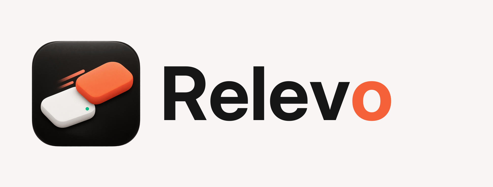
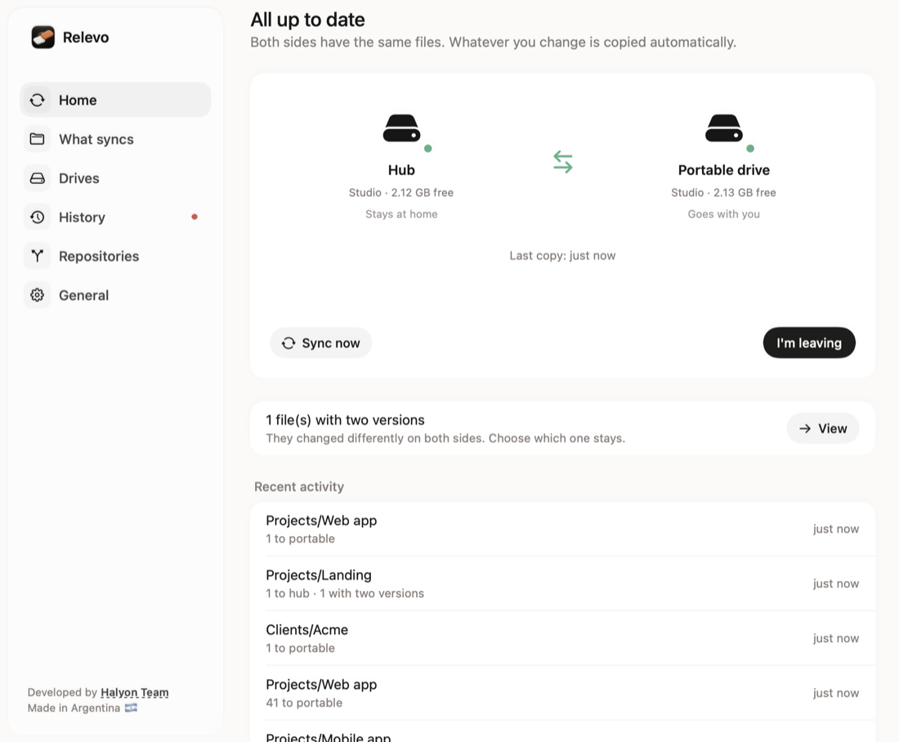
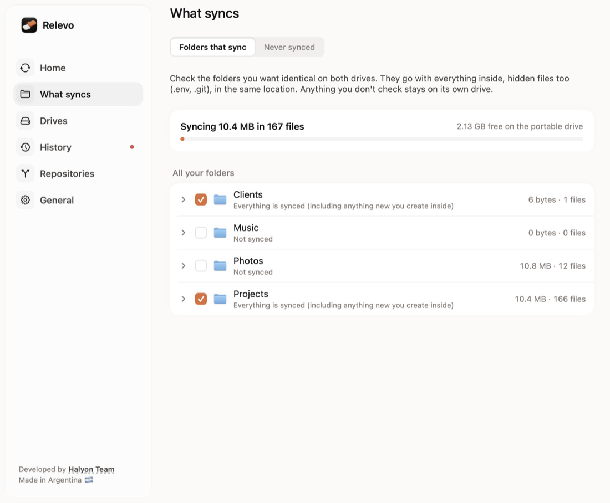
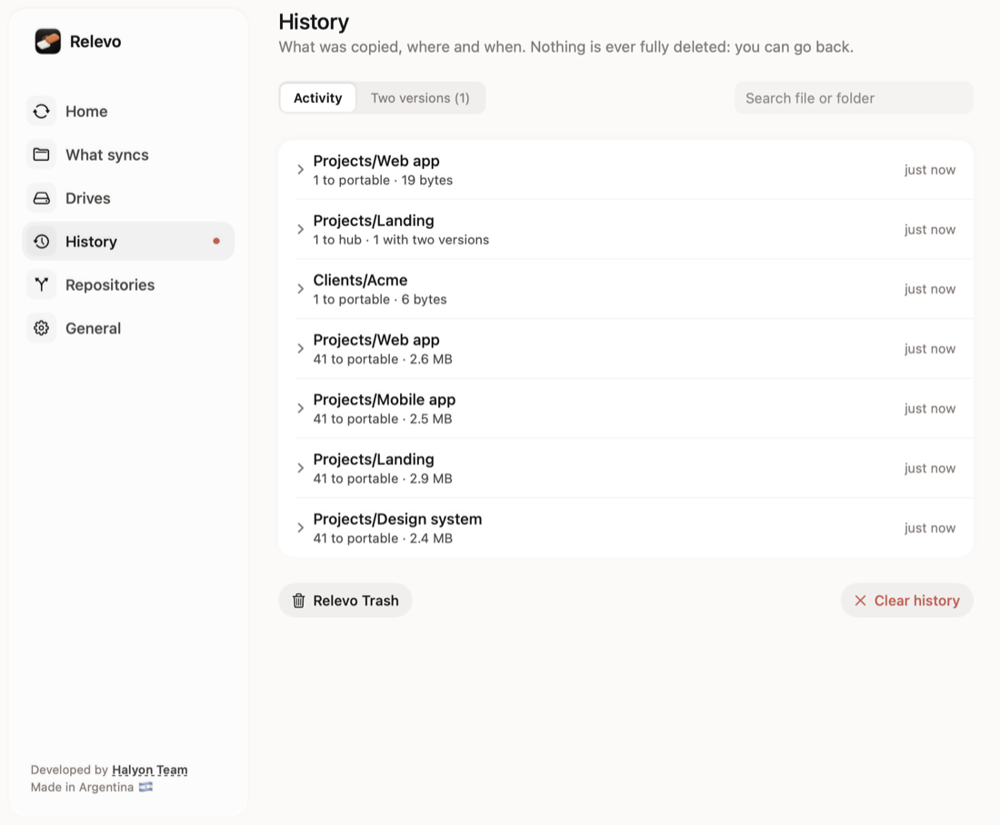

<p align="center"></p>

<p align="center"><b>Your work drive, at home and on the go — always the same.</b><br>
A tiny macOS menu bar app that keeps a <i>hub</i> (the drive or folder you work on at home) and a <i>portable drive</i> identical, in both directions.</p>

<p align="center"><a href="https://relevo.halium.app">Website</a> · <a href="docs/MANUAL.en.md">User guide</a> · <a href="LEEME.md">Leer en español</a></p>

---

## What it does

- **Live, two-way sync.** While both drives are plugged in, every change is copied within seconds. Work on the portable drive somewhere else; when you come back and plug it in, Relevo brings those changes home.
- **Eject and go.** With both drives connected everything is already copied, so ejecting the portable drive is enough (from Relevo or Finder). “I'm leaving” copies the last changes (only what's pending: seconds) and ejects. If something is using the drive, background processes are closed automatically and apps with windows are listed so you can close them in one click.
- **“Wait” when you get back.** When you plug the portable drive in at home (or turn on the Mac with both drives), Relevo renames the drives and brings in what you did away. If that takes more than a few seconds, a notification asks you to wait before opening your apps, and another one tells you when it's done and what came in. If an app (for example Claude) was already opened on the portable drive, Relevo tells you which one to close and lets you know when you can open it again, so it never ends up working on the wrong drive.
- **Checks only what changed.** macOS keeps track of which folders changed on each drive (even while Relevo is closed or the portable drive was used away): Relevo checks only those projects and, inside each one, only the folders that changed. With one or two pending files, syncing is instant even if the project has hundreds of thousands of files. When it can't know for sure (the first time, after a power cut or after unplugging a drive without ejecting it), it checks everything. Once a day, overnight, it checks everything just in case; if you leave while it runs, it stops by itself.
- **Same paths everywhere.** Away from home, the portable drive takes the hub's name: your projects live at the same path and your editor, terminal and tools find everything. At home it's called “<name> (portable)”, so two drives never share a name and it doesn't matter which one the Mac mounts first. Relevo renames it by itself, without unmounting anything, and can hide it from Finder while the hub is connected.
- **Made for developers and creatives.** Dependencies (`node_modules`, `.venv`, `Pods`) are synced by default, so your projects work away from home without downloading them again (you can turn it off). Build output (`.next`, `.build`, `DerivedData`…) is never copied. Hidden files (`.env`, `.git`) are. Databases, emulators and virtual machines (`.avd`, `.utm`, `.vmwarevm`, `.pvm`) are left alone while they are running and travel once when you close them, so a half-written copy never reaches the other drive.
- **Nothing is ever deleted for good.** Deleted or replaced files go to a Relevo Trash on each drive (kept 3, 7, 30 or 90 days; of files of 256 MB or more only the last version is kept). From the history you can recover them or go back to the previous version, and you can empty the trash at any time from General. If you delete a whole project, Relevo asks before deleting it from the other drive; if you don't answer, it's applied after 3 days.
- **Conflicts handled.** If the same file changed differently on both sides, both versions are kept and you choose which one stays. If a project has different commits on each drive, its `.git` folder is left alone (so the histories don't mix) and Relevo tells you to merge them with git.
- **Safe if you unplug mid-copy.** Files are written to a temporary name and renamed at the end; a journal remembers what was just written, so a drive yanked mid-copy is repaired instead of being treated as your deletion.
- **Repositories.** Clone from a link or from your GitHub list to the hub or straight to the portable drive, see which repos have changes, unpushed commits or are behind, pull, commit or merge branches. Hide the ones you don't care about.
- **More:** several links (e.g. projects to one drive, photos to another), folder tree with sizes, monthly deep check (byte-by-byte comparison), eject every drive at once, copy before sleep, pause for an hour or until tomorrow, optional drive encryption with a key stored in your Keychain, keyboard shortcuts and `relevo://` links for Shortcuts, Raycast or Alfred, English and Spanish.

Memory: ~30 MB idle, no leaks. A small copy (the everyday case) needs only a few MB more, even in a huge project: in a 500,000-file project, syncing one changed file takes 0.3 s and ~10 MB. Only the full check (the daily one, or after a power cut) looks at everything: ~650 bytes per file, given back when done.

## Screenshots

| Home | What syncs | History |
|---|---|---|
|  |  |  |

## Requirements

- macOS 14 or later, Apple Silicon.
- To build: Swift 6 (Xcode or just the Command Line Tools: `xcode-select --install`).
- The portable drive must be formatted as **APFS** (Disk Utility). exFAT/FAT drives don't keep permissions or links and can be damaged if unplugged.

## Build and install

There are no ready-made downloads yet: you build it yourself, it takes a minute.

```bash
git clone https://github.com/Halyon85/relevo.git && cd relevo
./compilar.sh            # builds build/Relevo.app
./compilar.sh instalar   # also copies it to /Applications and opens it
```

You don't need an Apple developer account. `compilar.sh` signs with your “Apple Development” certificate if you have one; otherwise it signs ad hoc, locally (macOS may then ask for permissions again after each rebuild). The first time, macOS asks for permission to send notifications and to access removable volumes.

To update, pull the latest code and build again: `git pull && ./compilar.sh instalar`. Builds published by Halyon Team (when there are any) will update themselves with [Sparkle](https://sparkle-project.org); see [docs/PUBLICAR.md](docs/PUBLICAR.md).

The full user guide, screen by screen, is in [docs/MANUAL.en.md](docs/MANUAL.en.md).

## Tests

Everything is tested with **disk images**, never with real drives:

```bash
swift run RelevoPruebas                 # every sync-engine scenario, run twice: full check and checking by zones
herramientas/prueba-desenchufar.sh 12   # forced unplugs mid-copy, both sides
herramientas/prueba-app.sh              # the whole app end to end, memory and leaks
herramientas/prueba-cifrado.sh          # encryption on a test image
herramientas/prueba-inteligente.sh      # checking only what changed (Relevo closed, away, no log, power cut) and stopping the daily check when you leave
herramientas/prueba-discos.sh           # drive names (swapped, away, “I'm leaving”, eject, apps open on the portable drive), deletions applied automatically and auto-unlocking an encrypted portable drive
```

> ⚠️ Relevo moves and replaces files. It is well tested, but it is a first version: try it with test data before trusting it with your only copy, and keep a backup.

## How it works

```
Sources/RelevoNucleo/   sync engine (no UI): scanner, last-sync state, planner, safe executor, journal
Sources/Relevo/         menu bar app: one coordinator per link, FSEvents watcher, drives, encryption, panels, updates
Sources/RelevoPruebas/  engine tests (run without Xcode)
herramientas/           end-to-end test scripts, demo screenshots and release tools
```

Relevo compares each side against how both looked at the end of the last sync (like Unison): a change on one side is carried to the other; different changes on both sides become a conflict and nothing is overwritten.

## Support the project

Relevo is free. If it saves you time, you can support it on [GitHub Sponsors](https://github.com/sponsors/Halyon85) (the **Sponsor** button at the top of this page).

## Contributing

Issues and pull requests are welcome, in English or Spanish: see [CONTRIBUTING.md](CONTRIBUTING.md). To report a security problem privately, see [SECURITY.md](SECURITY.md).

## License and credit

Relevo is open source under the [Apache License 2.0](LICENSE). You can use, modify and redistribute it, including commercially, **as long as you keep the [`NOTICE`](NOTICE) file and give credit: “Based on Relevo by Halyon Team — https://halyon.team”.** The name and logo are not licensed: see [TRADEMARKS.md](TRADEMARKS.md).

The app icon was made with AI-assisted tools. The wordmark uses the [Inter](https://rsms.me/inter/) typeface (SIL Open Font License). Updates use [Sparkle](https://sparkle-project.org) (MIT license).

---

<p align="center">Developed by <a href="https://halyon.team"><b>Halyon Team</b></a> · Made in Argentina 🇦🇷</p>
